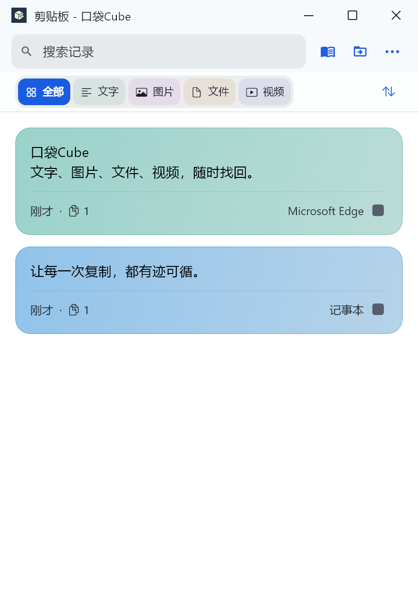
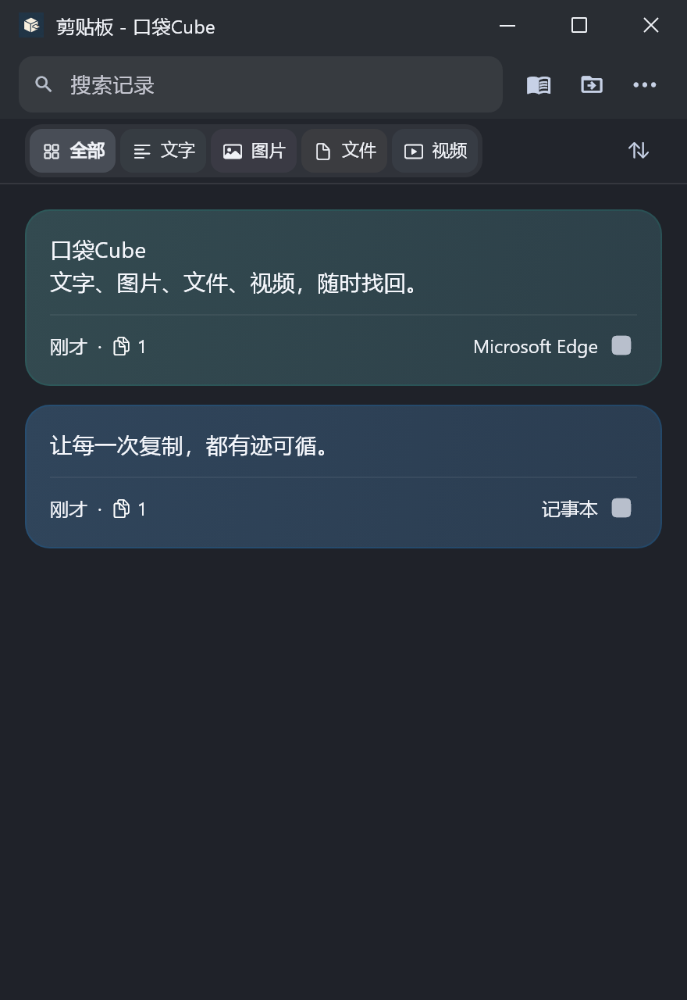

# 口袋Cube for Windows


**让每一次复制，都有迹可循。**

一个用 Flutter 构建的 Windows 剪贴板历史工具。复制过的文字、图片、文件和视频随时找回，通过右下角托盘快速搜索与再次复制；独立记事本保存常用内容，悬浮中转站衔接手头的文件和灵感。

界面与主要操作参考同作者的 [macOS 原版 SuperClipboard](https://github.com/haoyuanwu/SuperClipboard)，保留紧凑的单列卡片布局、分类筛选、来源着色，以及浅色、深色和半透明磨砂表面。原版参考提交：`63416c3ab0518c3cf2a07ed5c17a411be117b8d6`。

## 下载与安装

前往 **[最新版本下载](https://github.com/haoyuanwu/clipboard_win/releases/latest)**。

| 文件 | 使用方式 |
| --- | --- |
| `PocketCube-<版本>-windows-x64-setup.exe` | 中文安装向导，安装到当前用户目录，无需管理员权限，提供开始菜单入口和卸载功能 |
| `PocketCube-Windows-x64-v<版本>.zip` | 免安装版，完整解压后打开 `PocketCube.exe`，保留同目录的 DLL 和 data 文件夹 |
| `SHA256SUMS.txt` | 下载文件的 SHA-256 校验值 |

面向 Windows 10/11 x64，当前验证环境为 Windows 11 x64。升级前请从托盘退出旧版。当前发布包未做商业代码签名。卸载程序不会主动删除个人历史数据。

## 界面预览

默认使用 Windows 标题栏，右侧依次为最小化、最大化/还原和关闭。可在 **设置 → 通用与外观 → 标题栏样式** 中切换为 macOS，立即生效并保存选择；主窗口和中转站同步切换。

以下为使用示例数据的 Windows 界面，非 macOS 原版截图。

 

当前以 macOS **1.3.2** 为对齐基线；[逐项对照及平台差异](docs/ALIGNMENT_1.3.2.md)。

## 主要功能

- **自动记录**：保存文字、富文本、图片、文件与视频文件记录；重复内容合并计数，常用记录可置顶。
- **快速找回**：按内容、文件名、来源应用搜索，支持类型筛选、时间和次数排序。
- **托盘快捷复制**：单击右下角图标打开历史弹窗，单击卡片即可再次复制；关闭主窗口后继续后台运行。
- **独立记事本**：常用内容保存独立副本，支持更换保存目录，清空历史不影响记事本。
- **悬浮中转站**：窗口置顶，支持文字、图片和文件拖入、拖出；关闭后按设置时间清理。
- **全局快捷键**：`Ctrl + Alt + C` 打开快捷历史，`Ctrl + Alt + V` 打开中转站；设置中可录制、停用及恢复默认，冲突时保留原组合。弹窗支持 `Ctrl + 1–9` 按当前搜索结果复制。
- **文件组与收纳**：文件组可展开，逐项复制、拖出或定位；拖动文件时自动在当前屏幕左上角显示收纳入口，拖入入口并松手即可收纳。支持本地文件和常见虚拟文件数据源。
- **失效内容维护**：定期检查可读性，部分失效文件组继续使用剩余文件；可确认清理全部失效的未置顶记录，保留记事本和部分可用记录。
- **文件夹导入方式**：拖入文件夹可选择展开为文件组或保留整个文件夹，支持“下次不再询问”；在设置 → 悬浮中转 → 拖入文件夹中修改。展开只处理第一层，子文件夹和空文件夹保持完整。文件组在 Windows 和 Mac 外观下均有专用叠层文件图标。
- **内容预览**：图片预览、文件路径、富文本展示、视频封面与播放控制。
- **桌面外观**：浅色、深色、跟随系统，统一半透明磨砂表面；Windows 11 首次运行尝试直接显示托盘图标，后续保留手动设置。
- **本地存储**：剪贴板记录保存到本机，应用未实现云同步或记录上传功能。

## 常用操作

| 操作 | 效果 |
| --- | --- |
| 单击主窗口卡片 | 打开详情，右下角按钮再次复制 |
| 单击托盘弹窗卡片 | 直接复制并显示反馈 |
| 右键卡片 | 再次复制、置顶、加入记事本/中转、定位文件、删除 |
| 顶部书本按钮 | 切换历史与记事本 |
| `Ctrl+Alt+C` / `Ctrl+Alt+V` | 显示或隐藏快捷历史 / 悬浮中转 |
| 弹窗内 `Ctrl+1` 至 `Ctrl+9` | 按当前搜索或记事本列表顺序复制 |
| 拖动卡片 | 导出内容，复制次数与当前排序不变 |
| 拖动文件 | 自动显示左上角收纳入口，拖入并松手保存独立中转副本 |
| `Ctrl+F` | 在主窗口展开搜索 |
| `Esc` | 收起搜索或隐藏窗口 |
| 托盘右键 → 退出 | 退出后台程序，停止监听剪贴板 |

Windows 关闭系统“透明效果”时，桌面毛玻璃会使用较实的材质回退。应用不会自动修改系统透明设置。复杂富文本、视频格式与跨应用拖放的支持边界见 [复刻说明](docs/PORTING.md)。

## 存储

默认数据目录：`%APPDATA%\SuperClipboard`。口袋Cube 沿用旧版数据目录，升级后继续使用原有历史、记事本和设置。

- `state.json`：历史、设置和共享状态，写入时保留 `.bak`。
- `History/`：应用保存的历史图片；历史文件记录继续引用原始文件。
- `Notebook/notebook.json` 与记录附件：独立记事本，可迁移位置。
- `Transfer/`：独立中转副本，关闭窗口后按设置时间自动清理。
- `Cache/`：来源图标、剪贴板图片缓存和视频缩略图。

记事本和中转复制文件时保存独立附件。保存完成后，删除源文件不影响副本。清空历史不会删除记事本或源文件。
迁移记事本成功后会保留旧目录作为备份，当前应用仅使用新目录。

## 开发与验证

需要 Flutter Windows 工具链、Visual Studio C++ 桌面开发组件与 Windows SDK。

```powershell
flutter pub get
flutter analyze
flutter test
flutter build windows --release
```

开发输出：`build/windows/x64/runner/Release/`。
首次构建视频依赖会下载 libmpv 和 ANGLE；失败时可重新构建。`scripts/download_angle.py` 是本机下载故障时的辅助脚本，构建仍会检查依赖原始校验值。

`--data-dir <目录>` 可指定独立验证存档；`--no-startup` 跳过开机启动配置；`--no-capture` 禁用剪贴板采集（用于界面演示）；`--background` 后台启动。
正常运行保持单实例。验证用 `--preview-instance` 必须同时指定 `--no-capture --no-startup --data-dir <独立目录>`，用于隔离界面预览。

测试涵盖去重、稳定排序、置顶保留、独立副本、迁移与回滚、中转去重、富文本预览、界面交互和多引擎握手。
Windows 实测记录及界面截图位于 `docs/`。详见 `docs/PORTING.md`。

## 构建安装包与发布

需要 PowerShell 7+、Git、[GitHub CLI](https://cli.github.com/)、Flutter Windows 工具链、Visual Studio C++ 桌面开发组件，以及 Inno Setup 6.4 或更高版本。

只构建安装程序和免安装包：

```powershell
.\build-release.ps1
```

登录 GitHub 后，一条命令完成检查、构建、中文提交、推送与 Release 附件上传：

```powershell
gh auth login
.\publish.ps1
```

下次发布前，更新 `pubspec.yaml` 中的版本号，添加 `docs/release-notes/v<版本>.md` 中文说明，再运行脚本。自定义提交说明或只查看发布计划：

```powershell
.\publish.ps1 -CommitMessage "发布新版：优化剪贴板搜索与磨砂界面"
.\publish.ps1 -Plan
```

脚本不保存令牌、不强制推送、不覆盖已发布版本，也不上传 build、dist、原版参考代码和本地凭据。安装包作为 Release 附件上传。完整说明见 [发布流程](docs/RELEASING.md)。

## 来源与第三方组件

本仓库暂未单独指定项目许可证；第三方组件继续遵守各自许可证。原项目、视频组件和运行库来源见 [第三方说明](THIRD_PARTY.md)。
